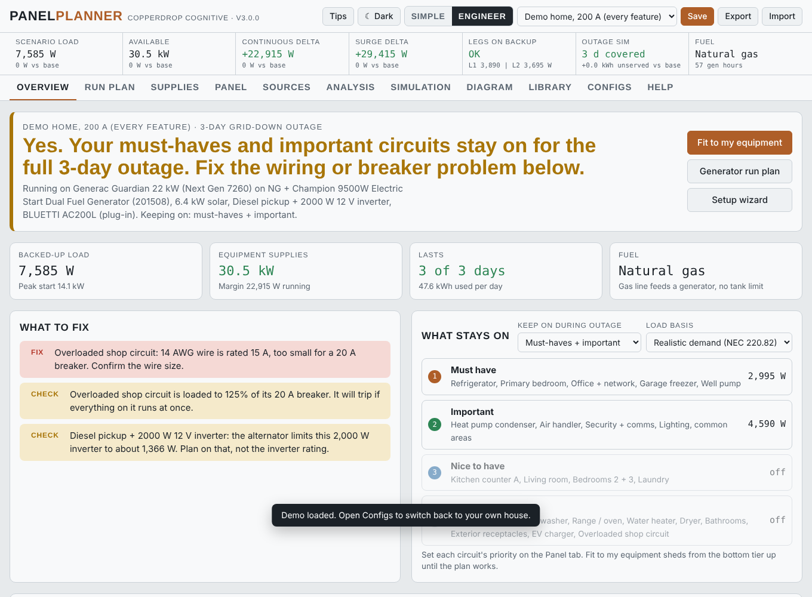
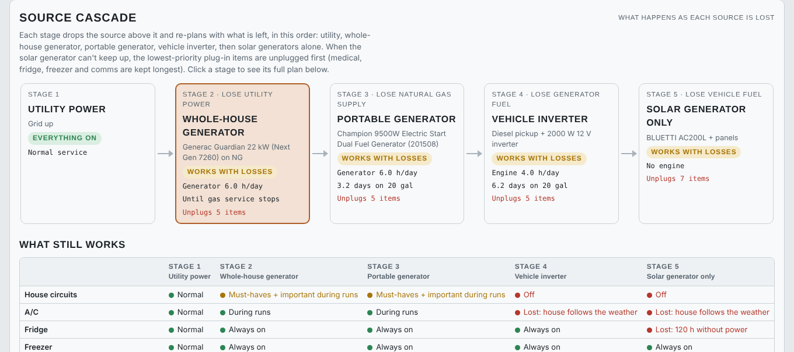
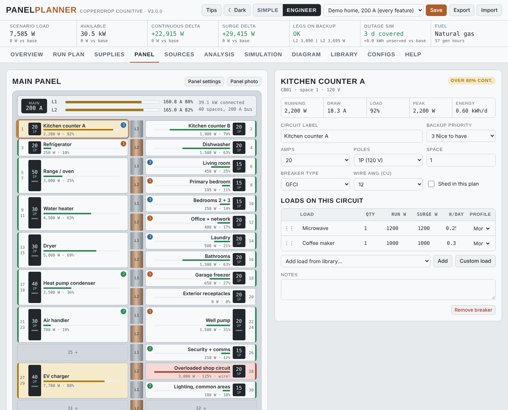

# Copperdrop Panel Planner

Plan your home's breaker panel and backup power in one HTML file. Map every circuit, add your utility service, generators, solar, batteries and vehicle inverter, and see whether your equipment can carry the house through a multi-day outage. It also tells you how little you can run the generator, what fuel to keep on hand, and what still works as each source is lost.

Made by Copperdrop Cognitive, LLC for engineers, homesteaders and families who prepare for outages.

## Try it in one minute

1. Download `index.html` (or the latest release zip) and open it in Chrome, Edge, Safari or Firefox. You don't need to install anything or create an account.
2. The first time you open it, you get the **demo house**. It is a fictional 200 A home that uses every feature. Press **Engineer** in the header to see all the tabs.
3. Open **Help → Demo tour** for a guided path through the demo.
4. You can press **Load demo** on the Overview or Configs tab at any time. The demo saves as its own config and leaves yours alone.

The demo includes:

- a natural gas Generac standby on an ATS;
- a dual fuel Champion portable on an interlock;
- a diesel pickup charging a BLUETTI AC200L through a 12 V inverter;
- two 200 W portable panels and a 6 kW roof array;
- a Tesla Powerwall 3, switched off so you can toggle it;
- one circuit that is overloaded on purpose.

## Build your own

1. Open **Configs**, then pick one of these starting points:
   - **Setup wizard**: answer a few questions.
   - A template: example home, generator subpanel, or blank 100 A or 200 A.
   - **Import**: load a JSON or Excel file someone built for you. `examples/demo-home.json` is a sample.
2. On **Panel**, match each breaker to your panel door card: space number, amps, 1-pole or 2-pole, and label. Tap a breaker to add what runs on it from the appliance library, then set its **backup priority** (1 must have, 2 important, 3 nice to have).
3. On **Sources**, add your equipment. The library has 440+ models. For anything else, choose Custom and enter the nameplate.
4. Read the **Overview** verdict. Press **Fit to my equipment** to shed the lowest-priority circuits until the plan works.
5. Check **Run Plan** for the fewest generator hours and the source cascade, then **Supplies** for the fuel to store.
6. **Save** the config, then **Export** it to Excel or JSON to back it up or share it with family.

## Features

**Panel**
- Breaker elevation showing 1P and 2P breakers, L1/L2 legs, load % and wire-size checks.
- Drag loads between breakers and see live deltas against a baseline.

**Loads**
- Appliance library with run and surge watts, hours per day and hourly profiles.
- Custom appliances are saved with the config.

**Sources**
- Utility, standby and portable generators, solar PV, home batteries, power stations, hybrid inverters, and a vehicle with a 12 V inverter (the alternator sets the limit).

**Sizing**
- Continuous and surge margins, per-leg and 240 V checks, two-motor surge, and the NEC 705.12 120% rule.
- Load basis: realistic demand (the NEC 220.82 method) or everything at once.

**Outage simulation**
- Hour by hour over 1 to 7 days: load profiles, solar curve, battery state of charge, generator start and stop, and stored fuel.

**Generator Run Plan**
- Finds the fewest run hours and starts that still keep food safe, keep the house within your temperature limits and keep the solar generator charged, within your quiet hours.

**Source cascade**
- Shows what still works as you lose the utility, the whole-house generator, the portable, then vehicle fuel, ending with solar generators alone.

**Supplies**
- Natural gas, propane, gasoline and diesel needed versus on hand, cost, and care tips.

**Recharge time**
- Recharge time for a power station from panels (by weather), wall, generator or vehicle.

**Exports**
- Excel workbook with live formulas and a panel graphic. You can import it again.
- PowerPoint with native, editable shapes.
- SVG block diagram that opens in Visio (Ungroup after opening).
- JSON.

**Modes and help**
- Simple and Engineer modes, light and dark themes.
- A Help tab with a user manual and glossary.
- Tips that explain any field when you hover over it.

## Privacy

Everything runs in your browser. Configurations are saved in that browser's local storage on that device and are never uploaded anywhere. Export to JSON or Excel to move them between devices.

The page loads two open source libraries from public CDNs the first time you export: ExcelJS 4.4.0 and PptxGenJS 3.12.0. Everything else works offline.

## Repository layout

| Path | What it is |
| --- | --- |
| `index.html` | The whole tool: one self-contained file |
| `examples/demo-home.json` | The demo house as an importable config |
| `docs/` | Screenshots used in this README |
| `CHANGELOG.md` | Release history |

## Versions

Current: 3.0.0 (2026-11-15). See `CHANGELOG.md`.

Each release is packaged as `PanelPlanner_vX.Y.Z.zip`. The version shows in the tool header, the Help tab and every Excel export.

## Library ratings

The 440+ models were researched in Nov 2026, covering:

- **Power stations and home batteries**: EcoFlow, BLUETTI, Jackery, Anker SOLIX, Goal Zero, Tesla, Enphase, FranklinWH, EG4, SolarEdge.
- **Standby generators**: Generac, Kohler, Briggs & Stratton, Champion, Cummins.
- **Portable generators**: Honda, Champion, Generac, Westinghouse, DuroMax.
- **Inverters**: hybrids from Victron, Sol-Ark, Schneider and Growatt; 12 V inverters.
- **Solar panels and DC batteries**.

Ratings are typical. Check them against the datasheet for your exact model.

## Disclaimer

This is a planning aid. It does not replace an NEC Article 220 load calculation, a permit, or a licensed electrician. Connect any generator through listed transfer equipment, and never backfeed through an outlet.

## License

Copyright (c) 2026 Copperdrop Cognitive, LLC. Free for personal, non-commercial use. See `LICENSE`.
